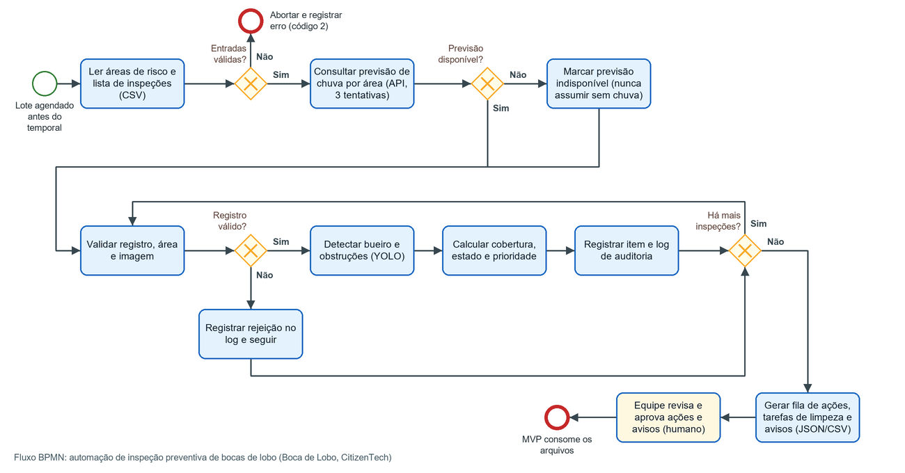
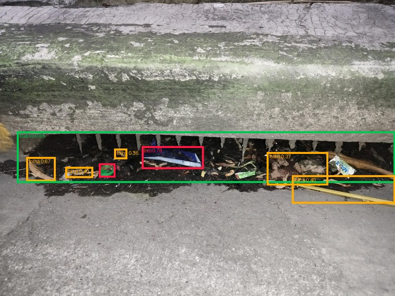
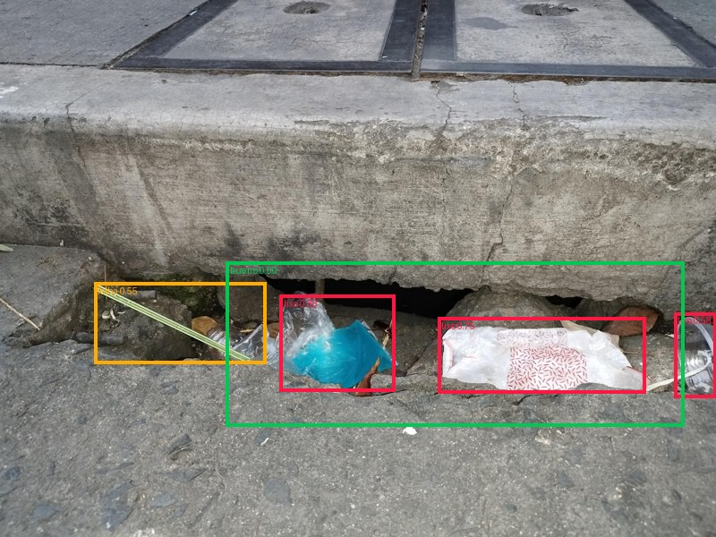

# Boca de Lobo

> **CitizenTech** (FIAP Global Solution 2026.2) · Engenharia de Software · 4º ano

O protótipo analisa fotos de bocas de lobo e sarjetas e estima possíveis
obstruções por lixo, folhas, pedras ou sedimento; quando a
previsão indica chuva forte, cruza o resultado com as áreas de risco para avisar
quem precisa agir: a **equipe de limpeza** (desentupir a tempo) e os
**moradores** (onde não passar). Os avisos são rascunhos, e toda ação exige
aprovação humana. Não há robô físico, publicação de avisos ou monitoramento contínuo.

## Ficha técnica do MVP

| Item | Descrição |
|---|---|
| Nome do produto | Boca de Lobo |
| Cidadão e território | Moradores de áreas baixas e periféricas que alagam todo verão; equipes municipais de limpeza e Defesa Civil como operadores |
| Problema, em uma frase | Ninguém sabe, antes do temporal, quais bocas de lobo estão entupidas nos pontos de maior risco |
| Proposta de valor | Fila priorizada e explicável de bueiros a limpar e rascunho de aviso aos moradores, gerados antes da chuva |
| Arquitetura | Fotos → **detector YOLO** → **regra de cobertura** → **automação** (previsão + áreas de risco) → arquivos estruturados (`output/`) consumidos por equipe e canal de avisos |
| Fontes de dados | Drainage Dataset (Roboflow Universe, CC BY 4.0); previsão da Open-Meteo (API pública); **áreas de risco e inventário simulados**, pois não há dados municipais de um bairro-piloto |
| Modelos de IA | YOLO11n (visão computacional). Sem IA generativa neste componente |
| URL do MVP e repositório | [github.com/iancancian/GS2026ACV](https://github.com/iancancian/GS2026ACV) · MVP: execução por linha de comando (sem URL pública) |
| Indicadores de impacto | Em um piloto futuro: bueiros verificados antes da chuva; tempo entre inspeção e limpeza; alertas confirmados em campo; cobertura de áreas periféricas. Ainda não medidos pelo protótipo |
| ODS conectados | **11** Cidades e comunidades sustentáveis · **13** Ação contra a mudança do clima · **10** Redução das desigualdades |

**Equipe:**

- Açussena Macedo Mautone — RM 552568
- Felipe Heilmann Marques — RM 551026
- Felipe Voidela Toledo — RM 98595
- Carlos Eduardo Caramante Ribeiro — RM 552159
- Ian Cancian Nachtergaele — RM 98387

**Vídeo:** demonstração local em [docs/Demonstracao_Applied_Computer_Vision.mp4](docs/Demonstracao_Applied_Computer_Vision.mp4);
o MP4 contém duas inferências reais sobre imagens do teste, é silencioso e tem
legendas. Não é uma transmissão ao vivo. O arquivo fica disponível no repositório
após o push; roteiro para narração opcional em [docs/ROTEIRO_VISAO.md](docs/ROTEIRO_VISAO.md).

**Relatório da disciplina:** [Applied Computer Vision](docs/Relatorio_Applied_Computer_Vision.pdf).
O repositório contém o código, os pesos finais, exemplos revisados e esses
entregáveis. O dataset completo não é versionado; para reproduzir o treino,
baixe o ZIP indicado em [docs/DATASET.md](docs/DATASET.md).

## Como funciona



1. O YOLO detecta `bueiro`, `lixo`, `folha`, `pedra` e `sedimento` em cada foto.
2. O **estado do bueiro é calculado**, não aprendido: fração da caixa do bueiro
   coberta pelas obstruições (sem contar sobreposição duas vezes). Abaixo de 10%
   `sem_obstrucao_visivel`; de 10% a menos de 80% `parcialmente_obstruido`; a partir de 80%
   `entupido_provavel`.
3. A automação consulta a previsão por área, aplica a regra de prioridade
   (`alta`, `media`, `programada`, `sem_acao_sugerida`, `revisao_manual`) e grava:
   `action_queue.json`, `tarefas_limpeza.csv` e `avisos_moradores.json`.
4. Falhas por item (foto ausente, área desconhecida, duplicado, caminho
   inválido, erro do modelo) são registradas com o motivo e o lote continua.
   Previsão fora do ar vira `indisponivel`, **nunca** "sem chuva".

Exemplos de detecção (fotos de teste do dataset, CC BY 4.0; caixas verdes =
bueiro, vermelhas = lixo, amarelas = folha):

 

## Resultados (conjunto de teste, 96 imagens)

| mAP50 geral | Bueiro (mAP50 / recall) | Lixo | Folha | Pedra | Sedimento |
|---:|---:|---:|---:|---:|---:|
| 0,39 | 0,73 / 0,76 | 0,43 | 0,11 | 0,54 | 0,16 |

O detector é uma **linha de base**: folha e sedimento são fracos e o teste é
pequeno. Detalhes e limitações em [docs/RESULTADOS.md](docs/RESULTADOS.md).

## Como executar

Requer Python 3.10+ (treino validado em Python 3.12). O peso final
`models\best.pt` está incluído; o dataset bruto e o ZIP não estão. Para preparar
o ambiente em Windows a partir da raiz do projeto:

```powershell
python -m venv .venv
.\.venv\Scripts\Activate.ps1
# GPU NVIDIA: instale antes o PyTorch do seu CUDA (https://pytorch.org); sem GPU, o passo abaixo usa CPU
python -m pip install -e .
```

### Reproduzir o treino e a avaliação

Baixe do Roboflow o *Drainage Dataset* no formato YOLOv8 e sem augmentation;
o ZIP original e as imagens não são distribuídos neste repositório. Em seguida:

```powershell

# Importe o ZIP sem extraí-lo e valide imagens e rótulos.
python -m boca_de_lobo.import_roboflow --source "C:\caminho\Drainage Dataset.v1-v1.yolov8.zip"
python -m boca_de_lobo.dataset

# Treino opcional (GPU NVIDIA: --device 0). O YOLO11n já foi treinado.
python -m boca_de_lobo.train --model yolo11n.pt --name yolo11n --epochs 80
python -m boca_de_lobo.evaluate --weights runs/boca_de_lobo/yolo11n/weights/best.pt
```

### Demonstração e testes

```powershell
# Gera JSON, relatório legível e imagem anotada para uma foto.
python -m boca_de_lobo.predict --image FOTO.jpg --weights models\best.pt --asset-id BUEIRO-001 --output output\inspecao.json --report output\inspecao.txt --annotated-image output\inspecao.jpg

# Automação integrada: áreas/inventário são exemplos simulados.
python -m boca_de_lobo.simulate --count 12 --inject-faults   # dados simulados
python -m boca_de_lobo.automation
python -m boca_de_lobo.automation --rain-threshold 0.15 --output-dir output_demo  # limiar de demonstração

# Testes automatizados (sem GPU, internet ou dataset)
python -m unittest discover -s tests -v
```

Para recriar o PDF, instale o extra de documentação e execute o gerador:

```powershell
python -m pip install -e ".[report]"
python scripts\gerar_relatorio_visao.py
```

Para recriar o vídeo, também é necessário baixar e importar o dataset completo,
pois a demonstração usa duas imagens do split de teste:

```powershell
python scripts\gerar_video_visao.py
```

O relatório de inspeção gerado pelo comando `predict` informa, por bueiro
detectado, a cobertura estimada, os materiais
sobrepostos e a triagem; a imagem mostra as caixas e suas confianças. A contagem
de materiais é o número de detecções, não o volume ou peso. Nenhum bueiro
detectado significa estado indeterminado e revisão manual; ausência de material
detectado não comprova que esteja livre. Cobertura é calculada sobre caixas 2D,
não mede área real nem entupimento interno; os limiares não foram calibrados.
O comando não consulta previsão: `--strong-rain` e `--risk-area` são informações
manuais opcionais. Não os use como evidência de condições reais.

O YOLO11n já foi treinado por 80 épocas e `models\best.pt` é o peso final. Não
é necessário treinar de novo para executar a demonstração. O YOLO26n foi uma
comparação exploratória interrompida na época 22; seus arquivos locais não
fazem parte da entrega.

## Estrutura do repositório

```text
src/boca_de_lobo/   código: import, validação, treino, avaliação, detecção, decisão, previsão, automação
tests/              testes automatizados e README com os cenários
docs/               protocolo do dataset, resultados, BPMN, relatório e demonstração de visão
assets/             fluxo BPMN (PNG) e exemplos de detecção
logs/               amostras de logs de execução (sem dados sensíveis)
data/               áreas de risco simuladas e lote de inspeções simulado
output/             exemplos de inspeção e saída consumida pelo MVP
output_demo/         exemplo da automação com limiar de chuva reduzido para demonstração; não é alerta meteorológico real
models/             pesos finais YOLO11n (best.pt)
scripts/            geradores de BPMN, relatório de visão e vídeo demonstrativo
dataset/            imagens e rótulos locais (não versionados); data.yaml
```

Validação local antes da entrega: `python -m boca_de_lobo.dataset` reconheceu
963 imagens e as cinco classes; `python -m unittest discover -s tests -v`
passou com 51 testes. Resultados do detector e limitações estão em
[docs/RESULTADOS.md](docs/RESULTADOS.md).

## Segurança, LGPD e IA responsável

- Sem credenciais no código; a previsão usa API pública sem chave. O CSV não
  consegue apontar para fora da pasta de imagens; o ZIP é lido em memória, sem extrair.
- Dados mínimos: apenas identificadores pseudônimos e nomes de arquivo nos logs;
  sem endereços, nomes ou coordenadas de moradores. Coordenadas são de áreas, não de pessoas.
- O dataset bruto, ZIP e rótulos locais não são versionados. Só as duas amostras
  licenciadas e revisadas usadas em `assets/` e nos entregáveis visuais estão no
  repositório; novas imagens devem ser revisadas quanto a privacidade e licença
  antes de compartilhar. Fotos próprias devem seguir [docs/DATASET.md](docs/DATASET.md).
- Pessoa no circuito: toda ação e todo aviso nascem `pendente_aprovacao`. O modelo
  não prevê alagamentos e não substitui vistoria nem a Defesa Civil.
- Viés e limites: dataset de outro contexto, sem local informado, classes
  desbalanceadas. Ausência de detecção nunca é tratada como "bueiro livre".

## Créditos e licenças

- Dataset: *Drainage Dataset* por **wqwdas**, Roboflow Universe, [CC BY 4.0](https://creativecommons.org/licenses/by/4.0/); houve conversão de formato e redução de resolução.
- Previsão: dados meteorológicos por [Open-Meteo.com](https://open-meteo.com/) (CC BY 4.0).
- Modelo base: Ultralytics YOLO (licença AGPL-3.0); avalie a licença antes de uso comercial.
